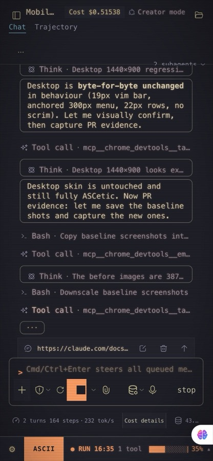
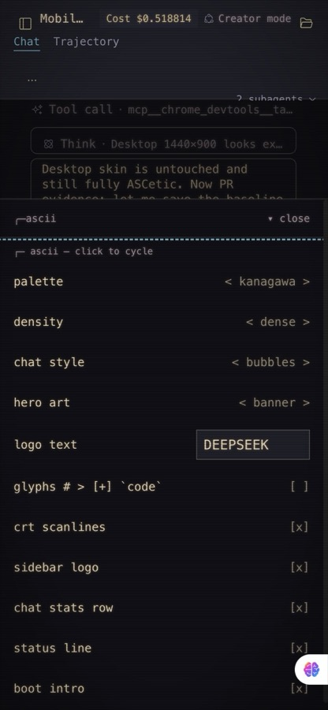
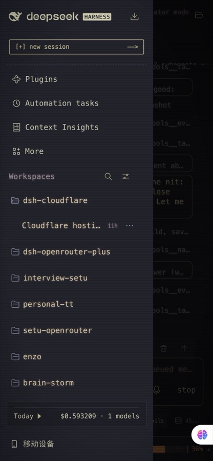

<h1 align="center">ASCetic</h1>

<p align="center">
  A compact ASCII / terminal theme for <b>DeepSeek Harness</b>.<br>
  <sub>ASCII + ascetic: nothing extra, everything drawn in characters.</sub>
</p>

<p align="center">
  
  <a href="https://ascii.rest"></a>
  <a href="LICENSE"></a>
</p>


## Features

- **Terminal look.** Monospace everywhere, square box-drawing chrome, hard drop shadows, Markdown that reads like source.
- **19 palettes.** Retro monitors (`phosphor`, `amber`, `ice`, `mono`), `vapor`, schemes after editor favourites, plus `auto` and `host`.
- **3 densities.** `cozy`, `compact`, `dense`: rows, spacing and type tighten together.
- **Status line.** Agent state and turn timer, steps and tok/s, a context meter, tokens and tool calls; click a segment for its details.
- **ASCII art.** Hero scenes from [ascii.rest](https://ascii.rest) on empty sessions, a framed New Session button, a retro boot intro with your own logo text.
- **Touch layout.** On a phone or tablet the status line becomes one 44px thumb row, popovers become bottom sheets with 48px rows, controls grow to real hit sizes and the chrome clears the safe areas. Desktop is untouched. See [docs/mobile.md](docs/mobile.md).

<table>
<tr>
<td width="31%"><br><sub>390px: one thumb row</sub></td>
<td width="31%"><br><sub>The menu as a bottom sheet</sub></td>
<td width="31%"><br><sub>Drawer with a scrim</sub></td>
</tr>
</table>


<table>
<tr>
<td width="50%"><br><sub>A session in <code>tokyo-night</code></sub></td>
<td width="50%"><br><sub><code>terminal</code> chat style on <code>amber</code>, CRT scanlines on</sub></td>
</tr>
<tr>
<td width="50%"><br><sub>Palette picker with swatches, <code>rose-pine</code></sub></td>
<td width="50%"><br><sub>Boot intro; the logo text is yours to change</sub></td>
</tr>
</table>

## Install

**Desktop**

Open **Plugins → Add plugin**, paste the address and press **Install**:

```
https://github.com/TABmk/dsh-theme-ascetic
```

**Web**

```sh
dsh plugin --profile web add github:TABmk/dsh-theme-ascetic
```

Then restart DeepSeek Harness.

**Update**

Desktop: open **Plugins → dsh-theme-ascetic**, press **Uninstall** and add it again.

Web: run the command again. Your settings are kept.

## Use

| Where | What |
|---|---|
| `ASCII` in the status line | Quick menu: palette, density, chat style, hero art, logo text, toggles |
| `pal` / `den` segments | Pickers; the palette list shows each palette's colours |
| `⚙` in the status line | The stock menu: Settings, Feedback, account |
| Hero art on an empty session | Click for the next art; `random` draws a new one per session |
| Settings → General → ASCetic | Every option in one place |

Tested on DeepSeek Harness `0.2.1-rc.3`.

## Thanks to ascii.rest

All the ASCII art in ASCetic comes from **[ascii.rest](https://ascii.rest)** by [bas3line](https://github.com/bas3line):
the hero scenes, the glinting block-letter banner, the `chat` piece, and the `mount()` engine that draws
the New Session button and the boot intro cell by cell. It is a lovely library, and this theme would be a
lot plainer without it. Thank you!

Palettes are inspired by Gruvbox, Nord, Dracula, Catppuccin, Tokyo Night, Rosé Pine, Everforest, Kanagawa
and Solarized; colours were adjusted where text needed more contrast.
